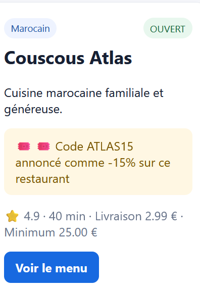
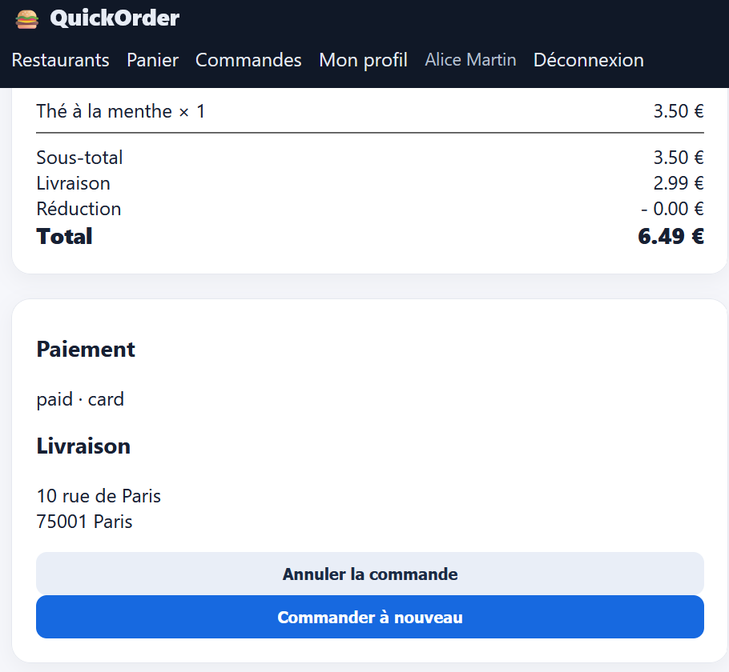

# Rapport de Bug : BUG-003

**Titre :** Non-application de la réduction lors de l'utilisation d'un code promotionnel  
**Contexte :** Prise en compte des codes promo lors de la validation du panier.  
**Préconditions :** Le restaurant Couscous Atlas propose un code promotionnel `ATLAS15` offrant -15% de réduction.  
**Étapes de reproduction :**
1. Se rendre sur la fiche du restaurant Couscous Atlas.
2. Ajouter un produit au panier (ex: Thé à la menthe à 3,50 €).
3. Appliquer le code promo `ATLAS15` annoncé à -15%.
4. Valider la commande et consulter le récapitulatif.

**Résultat attendu :** La ligne Réduction doit afficher le montant déduit (-15% du sous-total, soit -0,52 €) et le total doit être réduit en conséquence.  
**Résultat obtenu :** La réduction reste à `0.00 €` et le montant total est facturé plein tarif (6,49 €).  
**Preuve :** Capture de l'annonce du code `ATLAS15` (-15%) + Capture du récapitulatif de commande montrant `Réduction : - 0.00 €`.

Preuve :

**Sévérité :** Moyenne (Medium)  
**Priorité :** P2