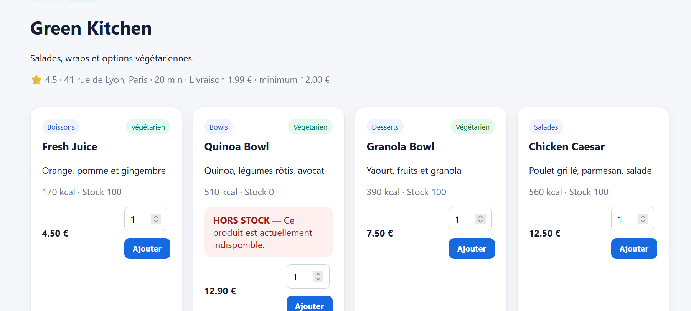
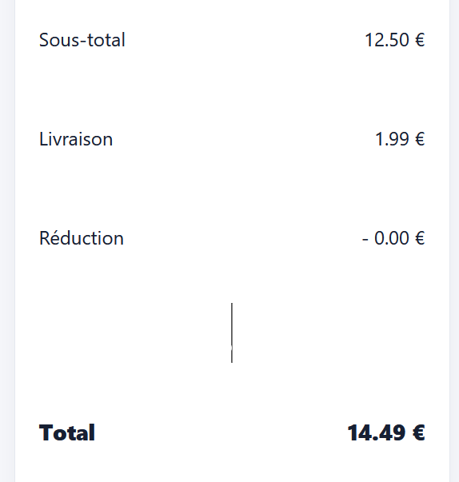

# Rapport de Test : TC-BUS-01

**Titre :** Application des frais de livraison  
**Catégorie :** Règle Métier  
**Statut :** PASS
**Date d'exécution :** 28 septembre 2026  
**Exécuté par :** Kavisha — QA Tester  

---

## 1. Objectif
Vérifier l'ajout et l'affichage des frais de livraison forfaitaires sur le total du panier.

## 2. Préconditions
* Restaurant configuré avec 1,99 € de frais de livraison.

## 3. Étapes d'exécution
1. Ajouter un plat de 12,50 € au panier.
2. Consulter le récapitulatif.

## 4. Résultat attendu
Les frais de livraison de 1,99 € s'affichent séparément et le total est égal à 14,49 €.

## 5. Résultat obtenu
Frais de livraison calculés et ajoutés correctement.

## 6. Preuve visuelle

