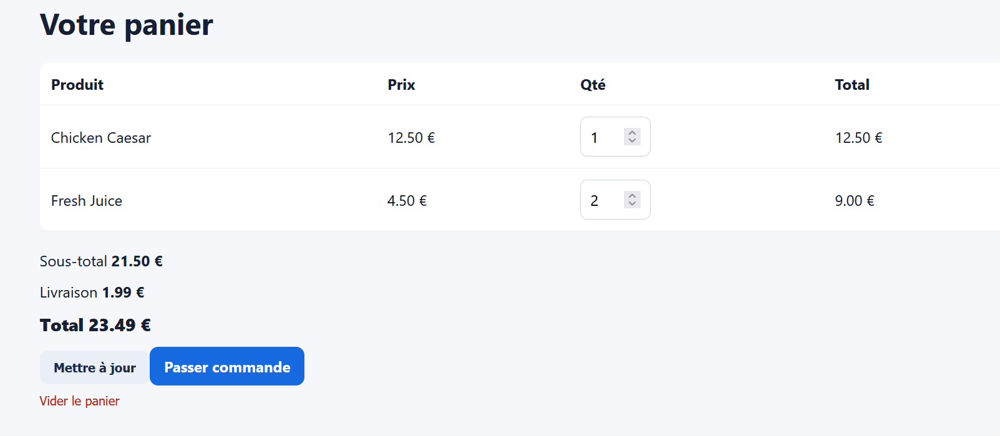

# Rapport de Test : TC-BUS-02

**Titre :** Calcul du sous-total multi-articles  
**Catégorie :** Règle Métier  
**Statut :** PASS  
**Date d'exécution :** 28 septembre 2026  
**Exécuté par :** Kavisha — QA Tester  

---

## 1. Objectif
Valider la formule de calcul du sous-total lors du cumul de plusieurs produits en quantités variées.

## 2. Préconditions
* Panier ouvert.

## 3. Étapes d'exécution
1. Ajouter 2 x Plat A (4,50 € l'unité).
2. Ajouter 1 x Plat B (12,50 € l'unité).
3. Vérifier le sous-total, les frais de livraison et le total.

## 4. Résultat attendu
Sous-total = `(2 * 4,50) + (1 * 12,50) = 25,00 €`.
Livraison = 1,99€.
Total = 21,50 + 1,99 = 23,49€

## 5. Résultat obtenu
Panier affichant un sous-total de 21,50 €.   
Frais de livraison de 1,99 €.   Total exact de 23,49 €.

## 6. Preuve visuelle
