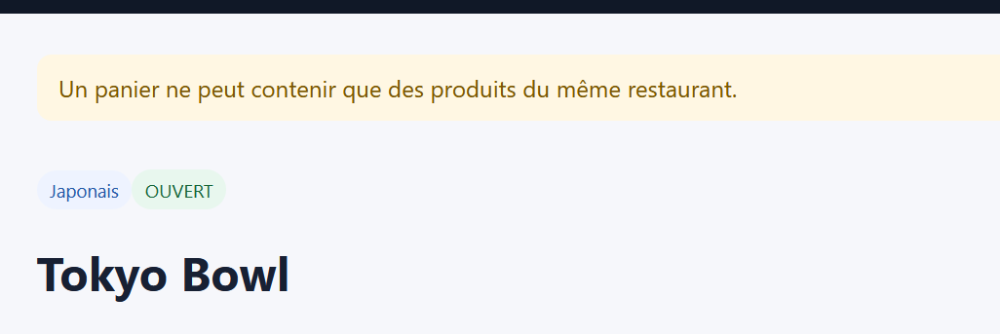

# Rapport de Test : TC-BUS-03

**Titre :** Interdiction de mixer plusieurs restaurants  
**Catégorie :** Règle Métier  
**Statut :** PASS   
**Date d'exécution :** 28 septembre 2026  
**Exécuté par :** Kavisha — QA Tester  

---

## 1. Objectif
Vérifier la règle métier qui interdit de mélanger des articles de restaurants différents dans un même panier.

## 2. Préconditions
* Un produit du Restaurant A est déjà présent dans le panier.

## 3. Étapes d'exécution
1. Naviguer vers la carte du Restaurant B.
2. Tenter d'ajouter un plat du Restaurant B.

## 4. Résultat attendu
Avertissement pop-up proposant de vider le panier existant avant d'ajouter le nouveau produit.

## 5. Résultat obtenu
L'application bloque le cumul et demande confirmation pour réinitialiser le panier.

## 6. Preuve visuelle
