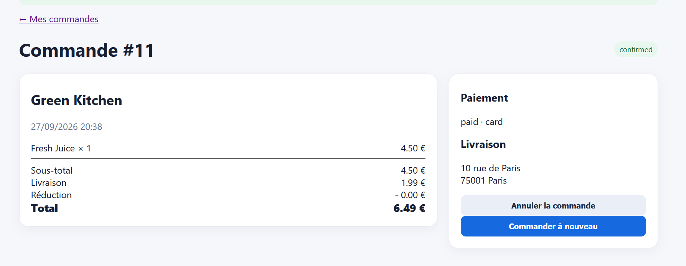

# Rapport de Test : TC-BUS-04

**Titre :** Contrôle du montant minimum de commande  
**Catégorie :** Règle Métier  
**Statut :** FAIL   
**Date d'exécution :** 28 septembre 2026  
**Exécuté par :** Kavisha — QA Tester  
**Anomalie associée :** BUG-001  

---

## 1. Objectif
Vérifier le respect du seuil minimum de commande imposé par un restaurant (ex: 12,00 €).

## 2. Préconditions
* Minimum de commande configuré à 12,00 € pour le restaurant sélectionné.

## 3. Étapes d'exécution
1. Ajouter un article de 4,50 € au panier.
2. Tenter de valider la commande.

## 4. Résultat attendu
Bouton de validation grisé ou message d'erreur : "Montant minimum de 12,00 € non atteint".

## 5. Résultat obtenu
La commande est validée sans qu'aucun contrôle de seuil minimum ne soit effectué.

## 6. Preuve visuelle
