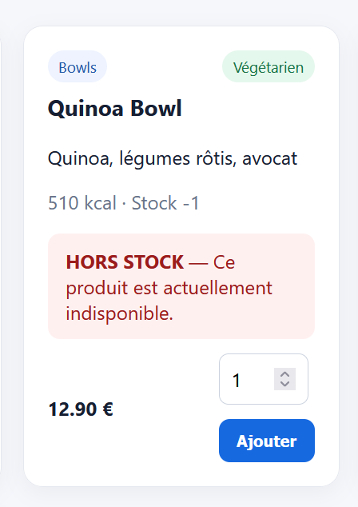
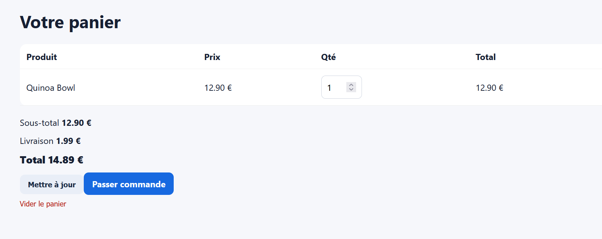
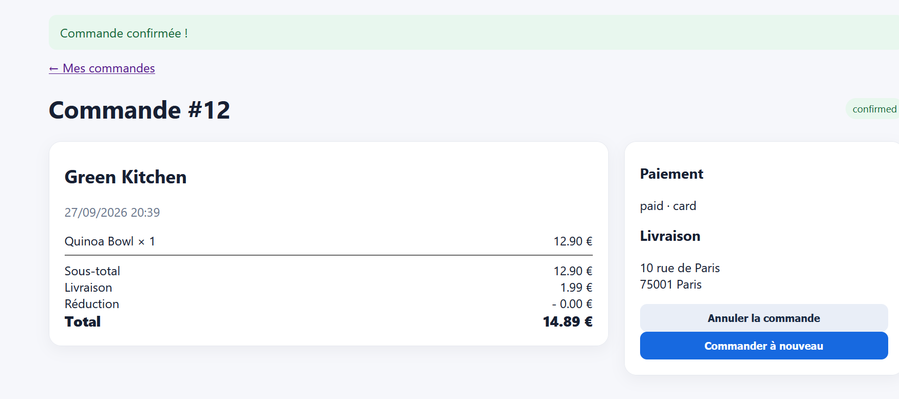

# Rapport de Test : TC-BUS-05

**Titre :** Blocage de commande sur un produit en Rupture de Stock  
**Catégorie :** Règle Métier  
**Statut :** FAIL 
**Date d'exécution :** 28 septembre 2026  
**Exécuté par :** Kavisha — QA Tester  
**Anomalie associée :** BUG-005  

---

## 1. Objectif
Vérifier qu'il est impossible de commander un produit dont le stock est égal à 0.

## 2. Préconditions
* Produit marqué "Hors stock" (`stock = 0`) en BDD.

## 3. Étapes d'exécution
1. Consulter la fiche du produit avec stock à 0.
2. Tenter de l'ajouter au panier et de passer la commande.

## 4. Résultat attendu
L'ajout au panier doit être impossible et le produit indiqué comme indisponible.

## 5. Résultat obtenu
Le produit s'ajoute au panier et la commande est validée avec succès.

## 6. Preuve visuelle

