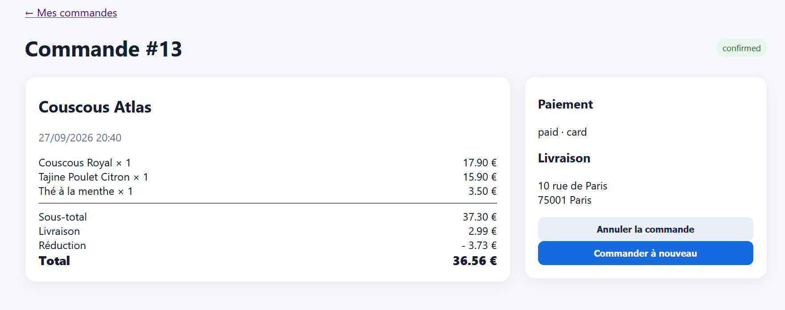

# Rapport de Test : TC-BUS-06

**Titre :** Calcul et application d'un code promo valide (`ATLAS15`)  
**Catégorie :** Règle Métier  
**Statut :** FAIL   
**Date d'exécution :** 28 septembre 2026  
**Anomalie associée :** BUG-003  

---

## 1. Objectif
Vérifier que l'application d'un code promo de réduction en pourcentage (ex: `ATLAS15` offrant 15% de remise) calcule exactement la remise sur le sous-total.

## 2. Préconditions
Panier validé chez Couscous Atlas pour un sous-total de 37,30 €.   Frais de livraison : 2,99 €

## 3. Étapes d'exécution
Saisir le code promo ATLAS15 sur la page de paiement.

Cliquer sur "Appliquer".

Vérifier le montant figurant sur la ligne "Réduction" et le montant Total.

## 4. Résultat attendu
15% de 37,30 € représente une déduction exacte de 3,73 € (Total final attendu : 37,30 + 2,99 - 3,73 = 36,56 €).

## 5. Résultat obtenu
Le système applique correctement une réduction de - 3,73 € sur le sous-total, produisant un total exact de 36,56 €.

## 6. Preuve visuelle
