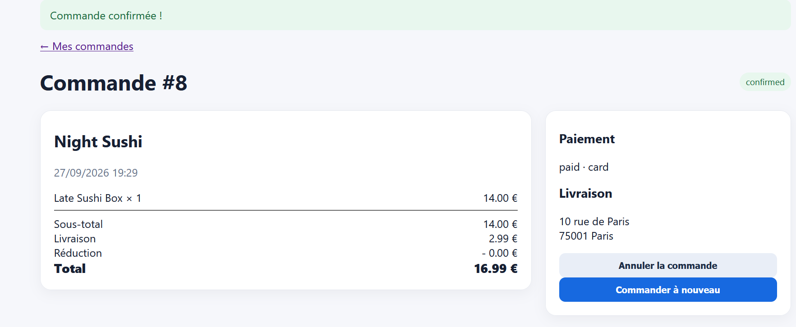

# Rapport de Test : TC-ERR-01

**Titre :** Commande sur un restaurant FERMÉ  
**Catégorie :** Erreur  
**Statut :** FAIL  
**Date d'exécution :** 28 septembre 2026  
**Exécuté par :** Kavisha — QA Tester  
**Anomalie associée :** BUG-004  

---

## 1. Objectif
Vérifier qu'un utilisateur ne peut pas valider de commande auprès d'un restaurant fermé.

## 2. Préconditions
* Au moins un restaurant a le statut "Fermé" en BDD.

## 3. Étapes d'exécution
1. Sélectionner un restaurant fermé sur la page d'accueil.
2. Ajouter un plat au panier.
3. Accéder au paiement et cliquer sur "Valider la commande".

## 4. Résultat attendu
Un message d'erreur bloque la validation : "Ce restaurant est actuellement fermé".

## 5. Résultat obtenu
La commande est acceptée et enregistrée en BDD malgré le statut fermé du restaurant.

## 6. Preuve visuelle
