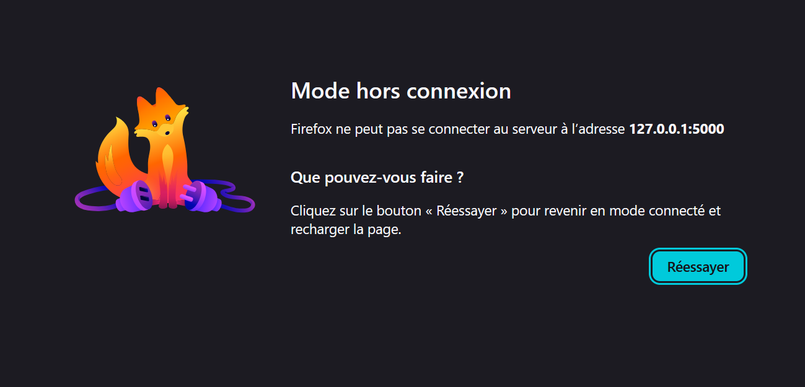

# Rapport de Test : TC-ERR-02

**Titre :** Perte de connexion pendant le paiement  
**Catégorie :** Erreur  
**Statut :** PASS 
**Date d'exécution :** 28 septembre 2026  
**Exécuté par :** Kavisha — QA Tester  

---

## 1. Objectif
Vérifier la gestion de l'interruption réseau lors de la soumission du paiement.

## 2. Préconditions
* Étape de confirmation du paiement.

## 3. Étapes d'exécution
1. Couper la connexion réseau (ou simuler un échec réseau).
2. Cliquer sur le bouton "Payer".

## 4. Résultat attendu
L'application affiche un message d'erreur explicite invitant l'utilisateur à vérifier sa connexion sans soumettre de commande en double.

## 5. Résultat obtenu
L'erreur de connexion est gérée proprement par l'IHM.

## 6. Preuve visuelle
