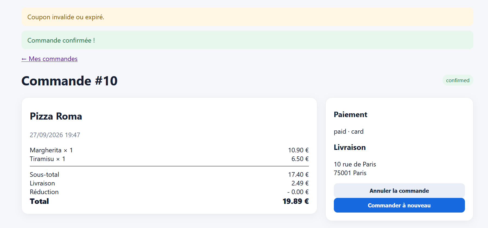

# Rapport de Test : TC-ERR-03

**Titre :** Application d'un code promo invalide  
**Catégorie :** Erreur  
**Statut :** PASS   
**Date d'exécution :** 28 septembre 2026  
**Exécuté par :** Kavisha — QA Tester  

---

## 1. Objectif
S'assurer qu'un code promo inexistant ou expiré ne s'applique pas au panier.

## 2. Préconditions
* Panier actif avec des articles.

## 3. Étapes d'exécution
1. Saisir le code `EXPIRE2025` ou `FAKECODE` dans le champ code promo.
2. Cliquer sur "Appliquer".

## 4. Résultat attendu
Message d'erreur : "Code promo invalide ou expiré". Le total du panier reste inchangé.

## 5. Résultat obtenu
Le code est refusé et le montant n'est pas modifié.

## 6. Preuve visuelle
