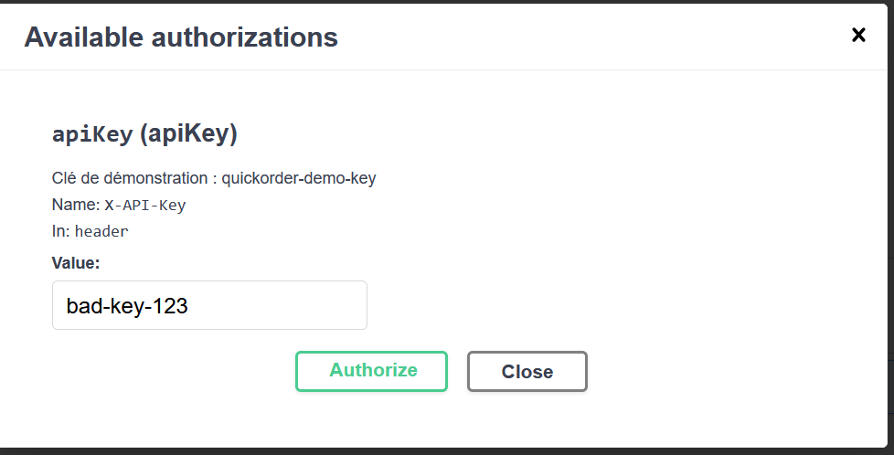
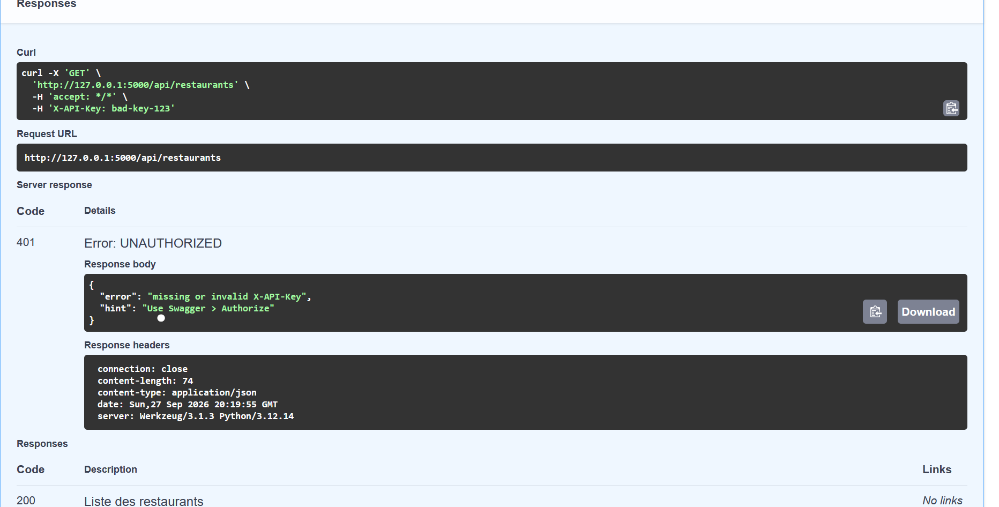

# Rapport de Test : TC-ERR-04

**Titre :** Accès API avec token d'authentification invalide  
**Catégorie :** Erreur  
**Statut :** PASS   
**Date d'exécution :** 28 septembre 2026  
**Exécuté par :** Kavisha — QA Tester  

---

## 1. Objectif
Vérifier la sécurité des endpoints API protégés en cas d'en-tête d'authentification erroné.

## 2. Préconditions
* Endpoint protégé (ex: `GET /api/user/orders`).

## 3. Étapes d'exécution
1. Envoyer une requête HTTP GET `/api/user/orders` avec un en-tête `Authorization: Bearer invalid_token`.

## 4. Résultat attendu
L'API répond avec le code HTTP `401 Unauthorized`.

## 5. Résultat obtenu
Code 401 retourné conformément aux règles de sécurité.

## 6. Preuve visuelle

