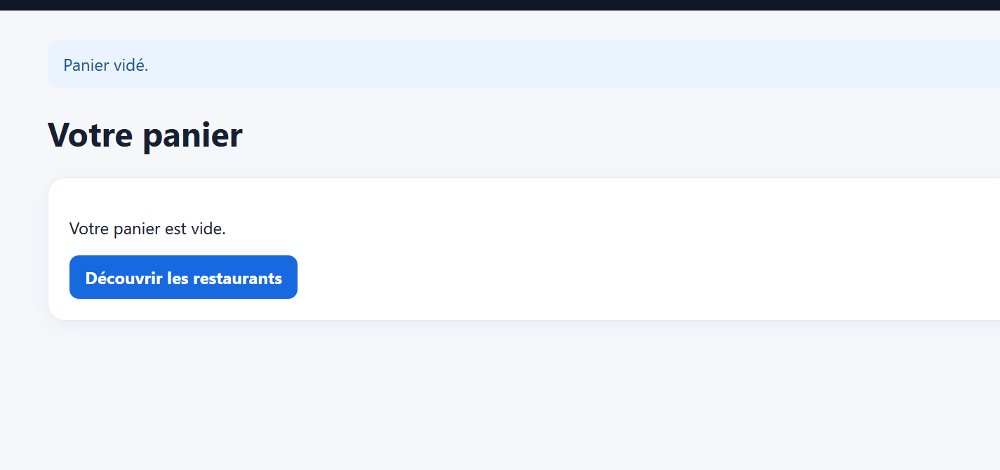

# Rapport de Test : TC-ERR-05

**Titre :** Tentative de validation d'un panier vide  
**Catégorie :** Erreur  
**Statut :** PASS   
**Date d'exécution :** 28 septembre 2026  
**Exécuté par :** Kavisha — QA Tester  

---

## 1. Objectif
S'assurer qu'un utilisateur ne peut pas accéder à l'étape de paiement avec un panier sans article.

## 2. Préconditions
* Panier utilisateur vide.

## 3. Étapes d'exécution
1. Tenter d'accéder directement à l'URL `/checkout`.

## 4. Résultat attendu
Redirection vers la page d'accueil ou le panier avec le message "Votre panier est vide".

## 5. Résultat obtenu
Accès bloqué et redirection effectuée.

## 6. Preuve visuelle
