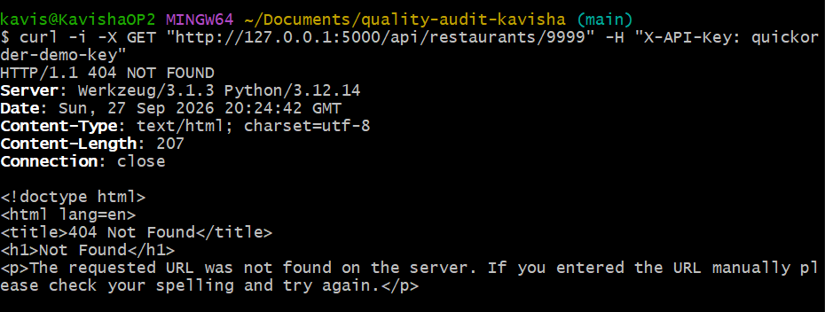

# Rapport de Test : TC-ERR-06

**Titre :** Requête API sur une ressource inexistante (404)  
**Catégorie :** Erreur  
**Statut :** PASS    
**Date d'exécution :** 28 septembre 2026  
**Exécuté par :** Kavisha — QA Tester  
**Anomalie associée :** BUG-007  

---

## 1. Objectif
Vérifier la réponse de l'API lorsqu'un identifiant de ressource inexistant est demandé.

## 2. Préconditions
* API REST active.

## 3. Étapes d'exécution
1. Envoyer une requête GET `/api/restaurants/9999`.

## 4. Résultat attendu
Code HTTP `404 Not Found` avec un corps de réponse JSON `{ "error": "Not Found" }`.

## 5. Résultat obtenu
Le code HTTP est bien `404`, mais la réponse est renvoyée au format HTML au lieu de JSON.

## 6. Preuve visuelle
