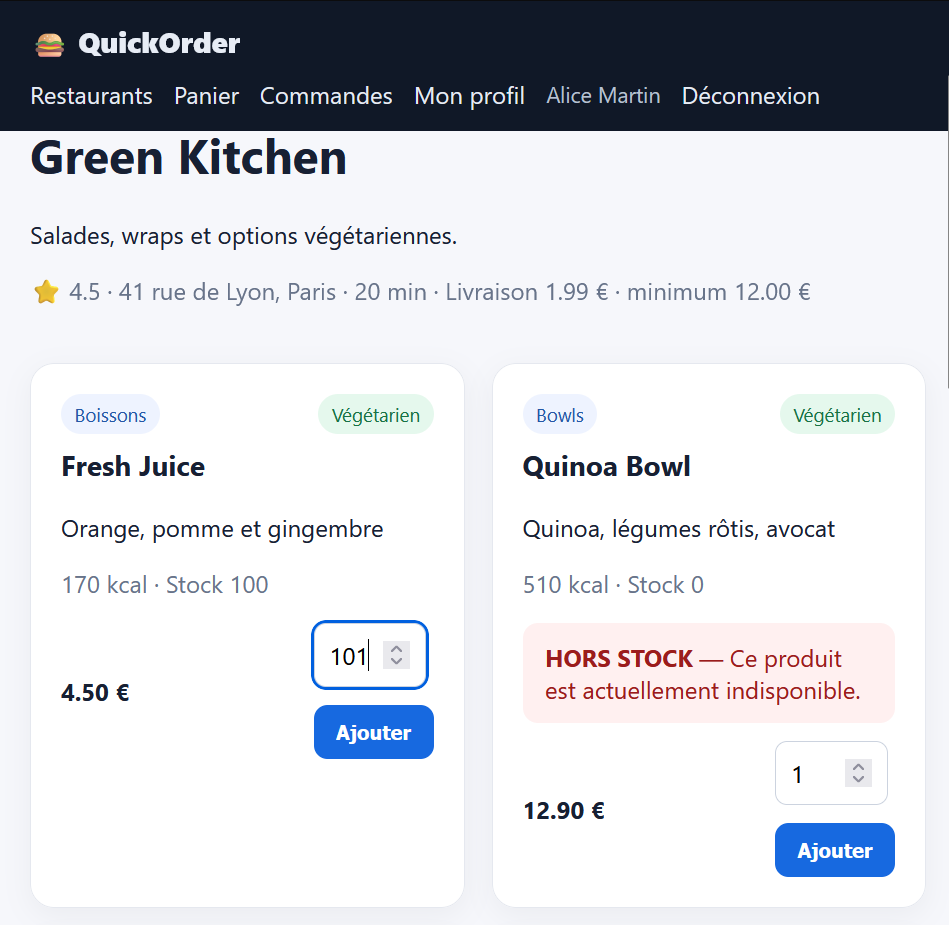
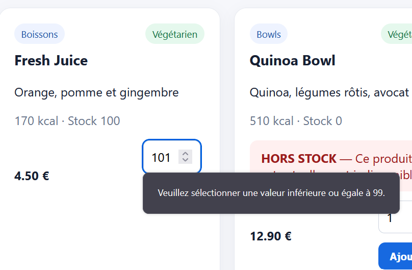

# Rapport de Test : TC-LIM-01

**Titre :** Quantité maximale autorisée dans le panier  
**Catégorie :** Limite  
**Statut :** PASS   
**Date d'exécution :** 28 septembre 2026  
**Exécuté par :** Kavisha — QA Tester  

---

## 1. Objectif
Vérifier le comportement de l'application lors de la saisie d'une quantité élevée (valeur limite).

## 2. Préconditions
* Sur la carte d'un restaurant.

## 3. Étapes d'exécution
1. Sélectionner un plat.
2. Saisir la quantité `99`.
3. Valider l'ajout au panier.

## 4. Résultat attendu
Soit la quantité de 99 est acceptée si le stock le permet, soit un message limite la commande à la valeur max autorisée sans faire planter l'application.

## 5. Résultat obtenu
La valeur limite est gérée proprement par l'application.

## 6. Preuve visuelle

