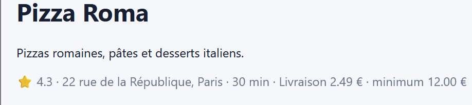

# Rapport de Test : TC-LIM-02

**Titre :** Commande au montant sous le seuil minimum autorisatif  
**Catégorie :** Limite / Règle Métier  
**Statut :** FAIL  
**Date d'exécution :** 28 septembre 2026  
**Anomalie associée :** BUG-001  

---

## 1. Objectif
Vérifier que le système bloque la validation d'une commande lorsque le montant total du panier est strictement inférieur au seuil minimum exigé par le restaurant (ex: 12,00 € pour Pizza Roma).

## 2. Préconditions
* Restaurant Pizza Roma sélectionné (minimum de commande affiché : 12,00 €).
* Utilisateur connecté.

## 3. Étapes d'exécution
1. Ajouter un seul produit d'un montant inférieur à 12,00 € (ex: Tiramisu à 6,50 €).
2. Consulter le panier (Sous-total : 6,50 €, Total avec livraison : 8,99 €).
3. Cliquer sur "Passer commande" et finaliser le paiement.

## 4. Résultat attendu
Le bouton "Passer commande" doit être désactivé ou un message d'erreur doit bloquer la validation ("Montant minimum de 12,00 € non atteint").

## 5. Résultat obtenu
La commande #4 est confirmée et enregistrée en base de données pour un montant total de 8,99 €, sans qu'aucun contrôle de seuil minimum ne soit appliqué.

## 6. Preuve visuelle
