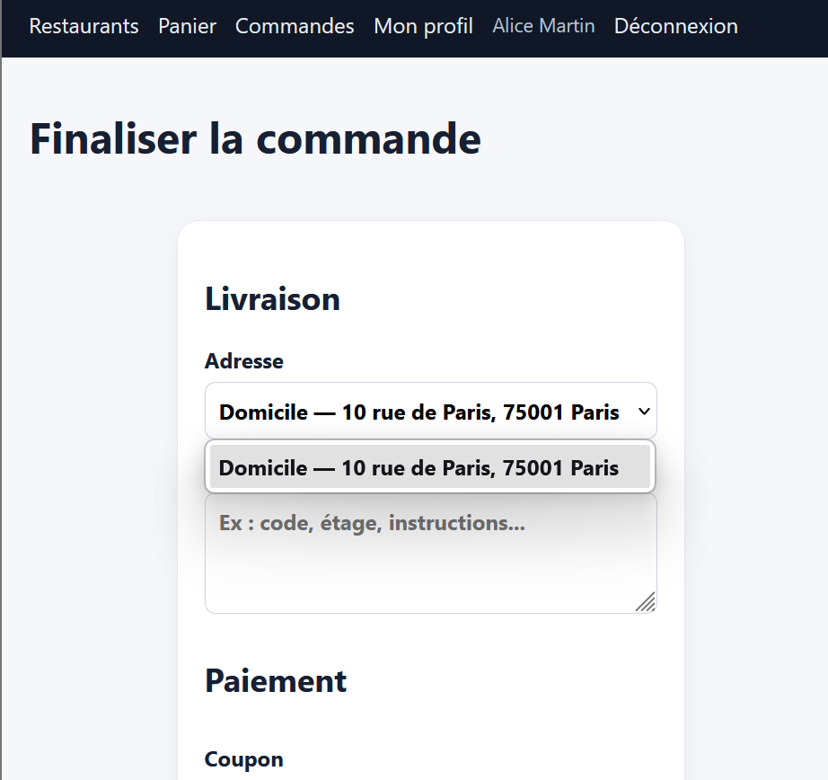
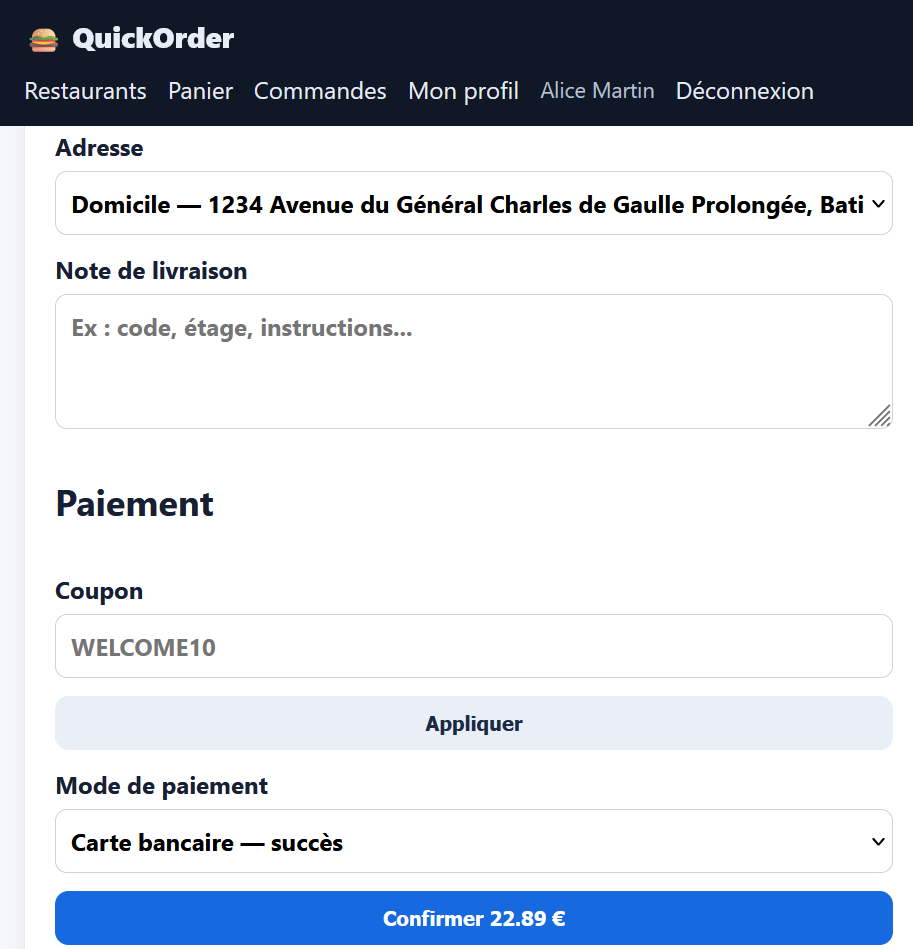
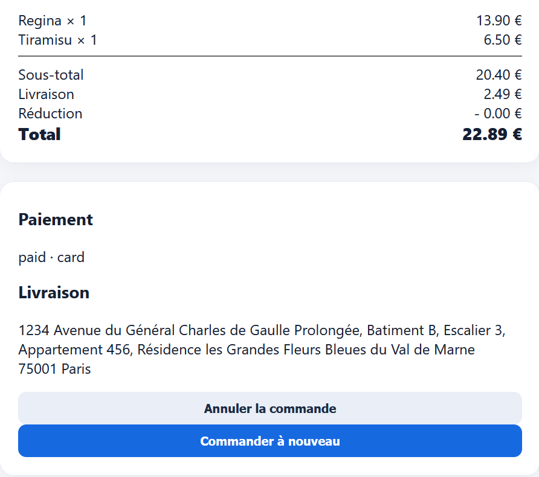

# Rapport de Test : TC-LIM-03

**Titre :** Adresse de livraison à taille maximale  
**Catégorie :** Limite  
**Statut :** PASS   
**Date d'exécution :** 28 septembre 2026  
**Exécuté par :** Kavisha — QA Tester  

---

## 1. Objectif
Tester la saisie d'une adresse de livraison extrêmement longue (limite de caractères du champ BDD).

## 2. Préconditions
* Étape de saisie de l'adresse de livraison.

## 3. Étapes d'exécution
1. Copier une chaîne de 250 caractères dans le champ adresse.
2. Valider le formulaire de livraison.

## 4. Résultat attendu
L'adresse est acceptée ou tronquée proprement sans lever d'exception d'erreur serveur (500).

## 5. Résultat obtenu
L'adresse est enregistrée en BDD sans crash.

## 6. Preuve visuelle
## 6. Preuve visuelle

