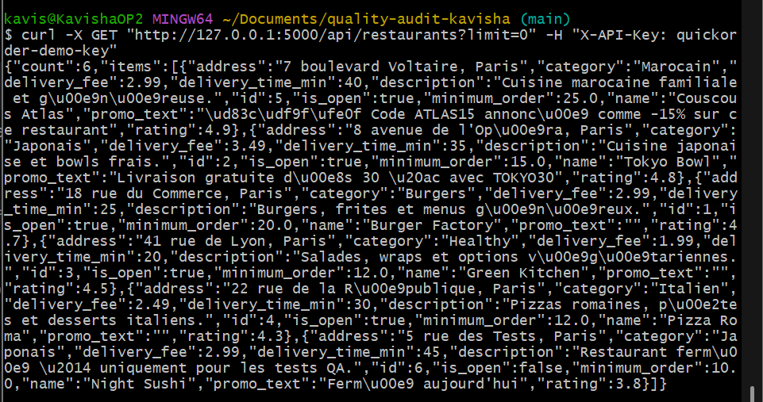

# Rapport de Test : TC-LIM-05

**Titre :** Recherche de restaurant avec chaîne minimale  
**Catégorie :** Limite  
**Statut :** PASS   
**Date d'exécution :** 28 septembre 2026  
**Exécuté par :** Kavisha — QA Tester  

---

## 1. Objectif
Tester le champ de recherche avec 1 seul caractère (limite basse).

## 2. Préconditions
* Sur la page d'accueil.

## 3. Étapes d'exécution
1. Saisir le caractère `a` dans la barre de recherche.
2. Lancer la recherche.

## 4. Résultat attendu
L'application retourne la liste des restaurants contenant la lettre "a" sans générer d'erreur SQL ou d'affichage.

## 5. Résultat obtenu
La recherche filtre correctement les résultats.

## 6. Preuve visuelle
