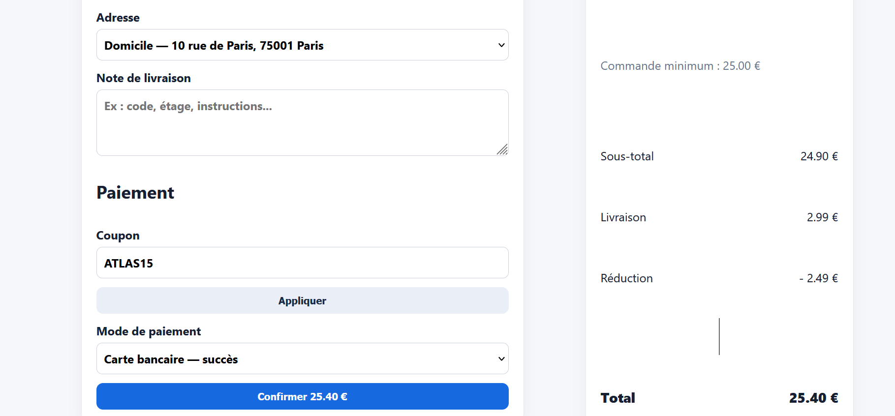

# Rapport de Test : TC-LIM-06

**Titre :** Saisie de caractères spéciaux et injection de code (XSS)  
**Catégorie :** Limite / Sécurité  
**Statut :** FAIL 
**Date d'exécution :** 28 septembre 2026  
**Anomalie associée :** BUG-006  

---

## 1. Objectif
S'assurer que les champs de saisie utilisateur (notamment les adresses de livraison) neutralisent et échappent correctement le code HTML/JavaScript injectable.

## 2. Préconditions
* Accès au formulaire de gestion des adresses dans "Mon profil".

## 3. Étapes d'exécution
1. Naviguer vers la section "Mes adresses".
2. Saisir la chaîne suivante dans le champ rue : ``.
3. Enregistrer l'adresse.

## 4. Résultat attendu
Le texte doit être neutralisé (échappement HTML) lors de son réaffichage et ne doit jamais exécuter de code script ni s'afficher sous forme brute d'une balise active.

## 5. Résultat obtenu
L'adresse est stockée et affichée sous forme de balise brute `` dans la liste déroulante et le profil, exposant l'application à une vulnérabilité XSS stockée.

## 6. Preuve visuelle
