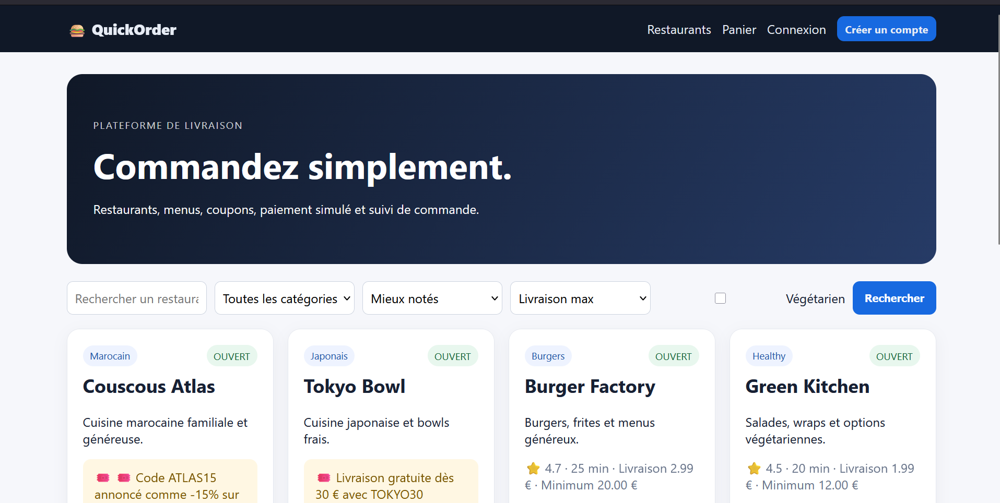
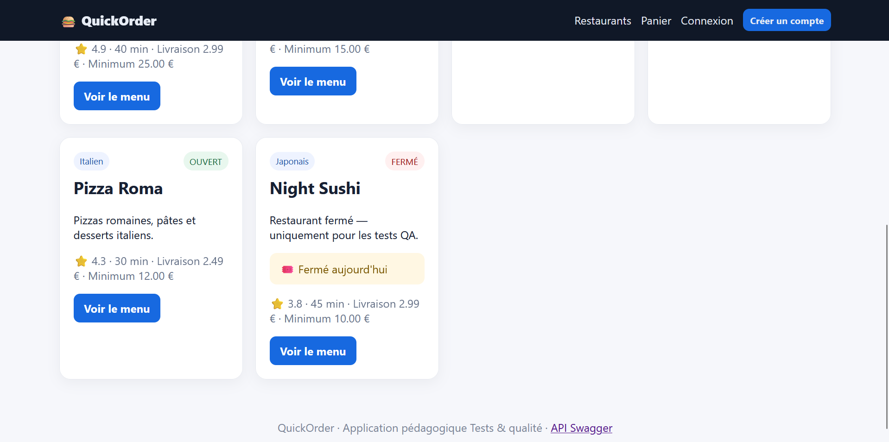

# Rapport de Test : TC-NOM-01

**Titre :** Affichage de la liste des restaurants  
**Catégorie :** Nominal  
**Statut :** PASS   
**Date d'exécution :** 28 septembre 2026  
**Exécuté par :** Kavisha — QA Tester  

---

## 1. Objectif
Vérifier que la page d'accueil de la plateforme QuickOrder charge et affiche correctement l'ensemble des restaurants disponibles avec leurs informations principales.

## 2. Préconditions
* L'application QuickOrder est lancée via Docker (`http://127.0.0.1:5000`).
* La base de données PostgreSQL est alimentée avec les jeux de données de test.

## 3. Étapes d'exécution
1. Ouvrir le navigateur et naviguer vers `http://127.0.0.1:5000/`.
2. Observer le chargement de la page d'accueil.
3. Vérifier la présence de la grille des cartes de restaurants.

## 4. Résultat attendu
La page s'affiche sans erreur HTTP. Toutes les cartes de restaurants affichent leur nom, image, type de cuisine et statut (Ouvert / Fermé).

## 5. Résultat obtenu
Toutes les cartes de restaurants chargent correctement. Les données sont conformes à la base de données.

## 6. Preuve visuelle

