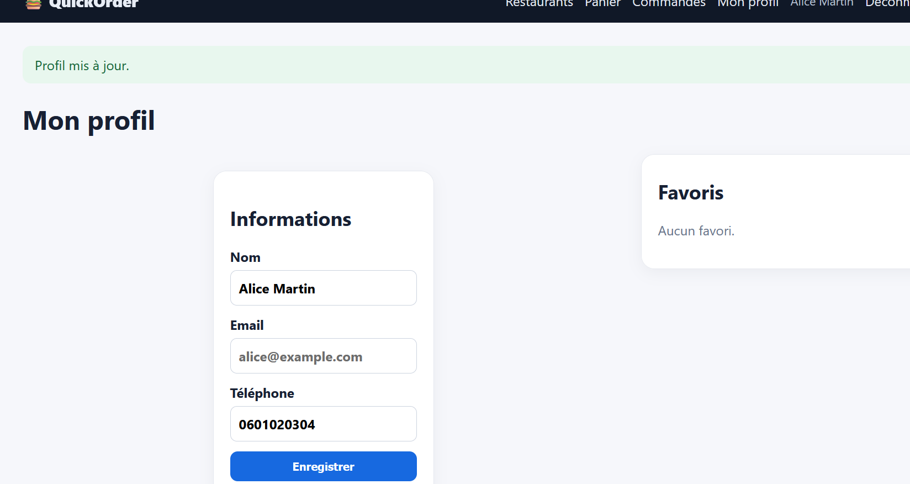
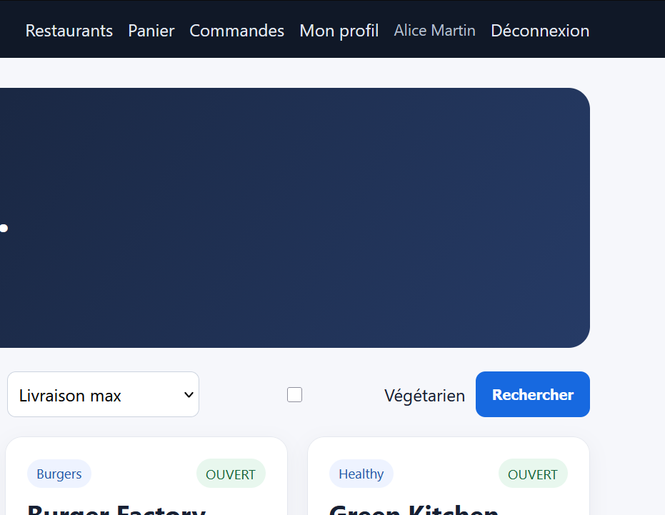

# Rapport de Test : TC-NOM-03

**Titre :** Connexion d'un utilisateur existant  
**Catégorie :** Nominal  
**Statut :** PASS  
**Date d'exécution :** 28 septembre 2026  
**Exécuté par :** Kavisha — QA Tester  

---

## 1. Objectif
Vérifier le processus d'authentification pour un utilisateur disposant d'un compte actif.

## 2. Préconditions
* Compte utilisateur fonctionnel pré-créé en BDD.

## 3. Étapes d'exécution
1. Naviguer vers la page `/login`.
2. Saisir l'adresse e-mail et le mot de passe associés au compte.
3. Cliquer sur "Se connecter".

## 4. Résultat attendu
Connexion établie, ouverture de session, redirection vers la page d'accueil et affichage du nom de l'utilisateur dans la barre de navigation.

## 5. Résultat obtenu
Connexion validée, cookie de session créé et nom utilisateur affiché.

## 6. Preuve visuelle

