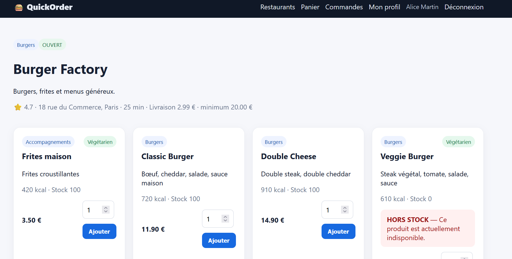

# Rapport de Test : TC-NOM-04

**Titre :** Consultation de la carte d'un restaurant  
**Catégorie :** Nominal  
**Statut :** PASS   
**Date d'exécution :** 28 septembre 2026  
**Exécuté par :** Kavisha — QA Tester  

---

## 1. Objectif
S'assurer qu'un utilisateur peut consulter le menu détaillé d'un restaurant.

## 2. Préconditions
* L'utilisateur est sur la page d'accueil.

## 3. Étapes d'exécution
1. Cliquer sur une carte de restaurant (ex: "Burgers Factory").
2. Parcourir la liste des catégories et des plats disponibles.

## 4. Résultat attendu
Le menu s'affiche avec la liste des plats, descriptions, visuels et prix unitaires en euros.

## 5. Résultat obtenu
Chargement complet du menu conforme à la carte enregistrée.

## 6. Preuve visuelle
