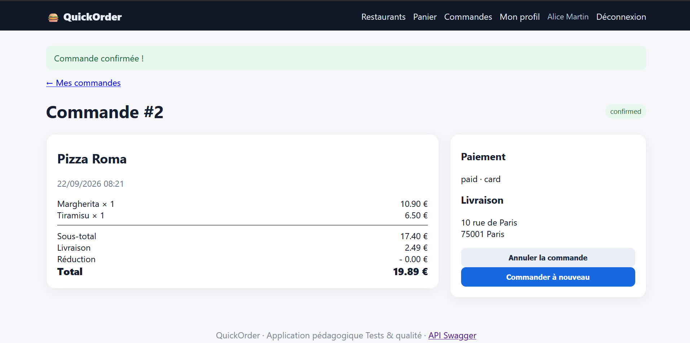

# Rapport de Test : TC-NOM-05

**Titre :** Ajout d'article et modification au panier  
**Catégorie :** Nominal  
**Statut :** PASS  
**Date d'exécution :** 28 septembre 2026  
**Exécuté par :** Kavisha — QA Tester  

---

## 1. Objectif
Vérifier l'ajout d'un plat au panier et la mise à jour des quantités.

## 2. Préconditions
* Sur la page du menu d'un restaurant ouvert.

## 3. Étapes d'exécution
1. Cliquer sur le bouton "Ajouter" d'un article.
2. Ouvrir le panier.
3. Augmenter la quantité de 1 à 2 via l'interface.

## 4. Résultat attendu
L'article est ajouté, la quantité passe à 2 et le sous-total du panier est recalculé en conséquence.

## 5. Résultat obtenu
Panier mis à jour correctement, quantités et montants recalculés sans erreur.

## 6. Preuve visuelle

