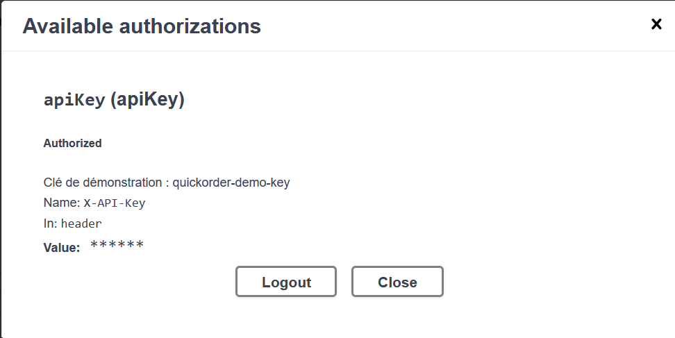
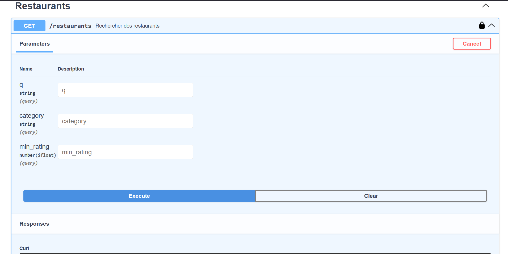
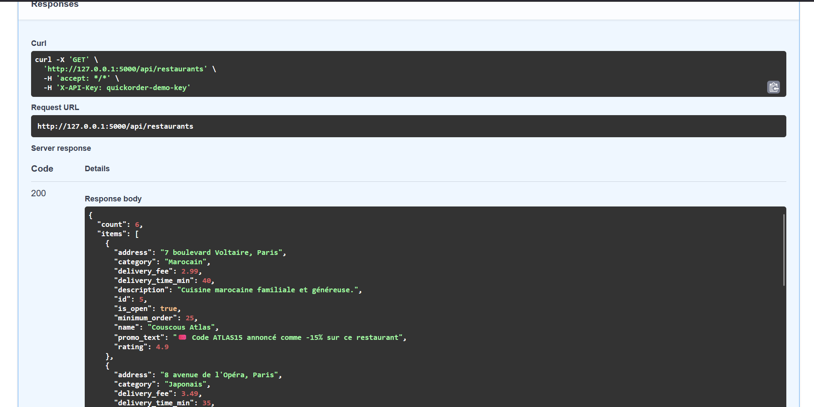
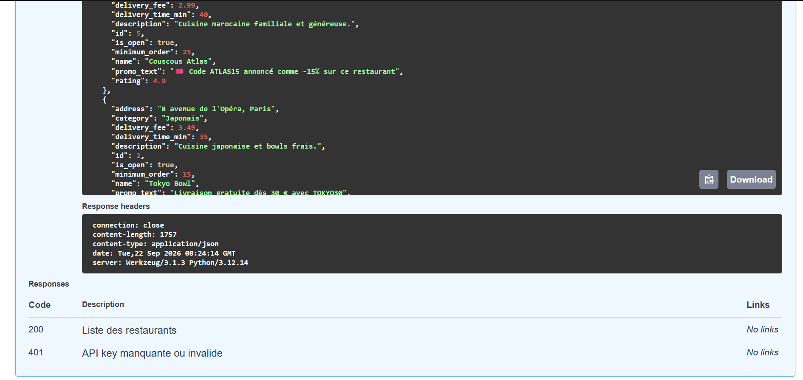

# Rapport de Test : TC-NOM-06

**Titre :** Parcours complet de commande nominale  
**Catégorie :** Nominal  
**Statut :** PASS   
**Date d'exécution :** 28 septembre 2026  
**Exécuté par :** Kavisha — QA Tester  

---

## 1. Objectif
Valider la finalisation complète d'une commande de l'ajout au panier jusqu'à la confirmation.

## 2. Préconditions
* Compte utilisateur connecté.
* Panier contenant au moins un produit valide.

## 3. Étapes d'exécution
1. Accéder à la page du panier (`/cart`).
2. Saisir l'adresse de livraison.
3. Sélectionner le mode de paiement.
4. Cliquer sur "Valider la commande".

## 4. Résultat attendu
La commande est enregistrée en BDD, un numéro de commande est généré, le panier est vidé et une page de confirmation s'affiche.

## 5. Résultat obtenu
Commande validée avec succès et confirmation affichée.

## 6. Preuve visuelle
## 6. Preuve visuelle

